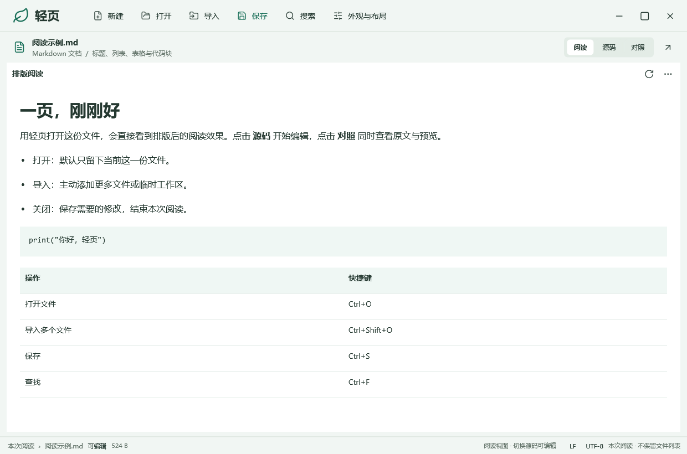
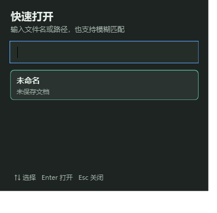

<div align="center">
  
  <h1>轻页 · Qingye</h1>
  <p><strong>一页，刚刚好。</strong></p>
  <p>Windows 本地文件阅读与轻度编辑工具。打开即用，按需加载。</p>
  <p>
    
    
    
  </p>
  <p><a href="https://github.com/TmxjTmxj/qingye/releases/latest">下载便携版</a> · <a href="docs/usage.md">使用说明</a> · <a href="#从源码构建">源码构建</a> · <a href="docs/README.md">文档索引</a></p>
</div>



## 少一点等待，多一点专注

轻页适合临时查看文件、阅读资料、修改文本，以及对照查看源码与排版结果。默认打开一份文件；需要更多内容时，再导入文件或工作区。

| 阅读 | 编辑 | 按需辅助 |
| :--- | :--- | :--- |
| Markdown 原生排版、类型化阅读、大纲导航 | 文本与代码编辑、查找替换、编码和换行保留 | 多文件对照、格式导出、原生 Agent 侧栏 |
| 文本和 Markdown 阅读无需网页进程 | 标签切换复用控件，快捷键贯穿主要流程 | 网页/PDF 预览及 Agent 运行时按需启用 |

## 开始使用

1. 从 [Releases](https://github.com/TmxjTmxj/qingye/releases/latest) 下载 Windows x64 便携 ZIP。
2. 解压后双击 `app/轻页.exe`，保留整个 `app` 目录。
3. 拖入文件，或按 `Ctrl+O` 打开。需要多个文件时按 `Ctrl+Shift+O` 导入。

需要 Windows x64 和 .NET Framework 4.8。网页、PDF、SVG 预览还需要系统 Microsoft Edge WebView2 Runtime；普通文本和原生阅读无需启用它。基础阅读与编辑不需要登录，Agent 需要自行配置模型端点。

## 常用操作，一步到位

| 操作 | 快捷键 |
| :--- | :--- |
| 打开 / 导入多个文件 | `Ctrl+O` / `Ctrl+Shift+O` |
| 保存 / 另存为 | `Ctrl+S` / `Ctrl+Shift+S` |
| 快速打开 | `Ctrl+P` |
| 下一份 / 上一份文件 | `Ctrl+Tab` / `Ctrl+Shift+Tab` |
| 查找 / 跳转行 | `Ctrl+F` / `Ctrl+G` |
| 阅读与源码切换 / 源码预览对照 | `Ctrl+E` / `Ctrl+Shift+V` |
| 文件与大纲 / 导入工作区 | `Ctrl+Shift+B` / `Ctrl+K` |
| Agent 侧栏 | `Ctrl+Alt+A` |

快速打开支持未保存文档、文件名模糊匹配和路径过滤。工作区扫描按需运行，最多 2000 个文件、6 层目录；关闭弹窗后取消，不建立磁盘索引。

<details>
<summary>查看深色快速打开</summary>



</details>

## 按文件类型，选择合适的阅读方式

| 文件 | 当前能力 |
| :--- | :--- |
| TXT、日志、源码、配置 | 阅读与编辑；按类型选择字体、换行与语法高亮 |
| Markdown | 原生排版、源码、对照；可选受限子集原位编辑 |
| JSON / XML | 可展开结构视图与源码，保留原始内容 |
| CSV / TSV、XLSX | 表格阅读；XLSX 展示已有缓存值，不重算公式 |
| DOCX / PPTX / RTF | 基础文本与结构阅读，不还原完整 Office 版式 |
| EPUB、图片、PDF | 章节阅读、图片查看或系统运行时预览 |
| HTML / SVG | 源码与按需预览；可连接已运行的本机开发服务 |

导出支持 TXT、Markdown、HTML、DOCX、CSV、XLSX 和 PDF，能力取决于当前内容。详细格式限制、大小预算与转换边界见 [完整说明](docs/usage.md#文件范围) 和 [编辑与导出](docs/editing-and-export-0.5.md)。

## 可控的 Agent

右侧原生对话面板由内置 DeepSeek Harness SDK 驱动，首次打开时启动本机运行时。它可以在当前文件或主动导入的工作区中读取、搜索并提出修改。

- 默认每次确认，展示差异后批准写入；也可切为只读。
- 自动编辑仅作用于当前主动导入的工作区；单文件仍逐次确认。
- 对话与草稿只留在本次运行内存中，退出即清空。
- 文件工具不开放终端、删除、任意网络请求或插件安装；未保存内容和磁盘冲突有保护。

将 `模型.example.txt` 复制为本机的 `模型.txt`，填写自己的端点、密钥与模型名。真实配置不进入 Git 或便携包。模型请求会向配置的服务发送相关上下文，具体行为和范围见 [Harness 集成说明](docs/harness-integration.md)。

## 轻量化的实际边界

普通阅读采用 WPF 原生控件；没有自动更新、后台托盘、常驻目录索引或账户服务。Agent 与网页预览需要额外资源，完整便携包约 **69.6 MiB**，解压后约 **212.4 MiB**。

0.11.1 本机采样：暖启动中位数 **449 ms**、普通关闭 **44 ms**、空白窗口工作集 **92.7 MiB**。这是特定机器上的观察值，未清理系统缓存，也没有同条件旧版对照，不代表所有电脑表现。[测量范围与验证](docs/lightweight-0.11.1.md)

## 从源码构建

准备 Git、Node/npm（用于准备固定 Agent 运行时），并在 Windows PowerShell 中执行：

```powershell
git clone https://github.com/TmxjTmxj/qingye.git
cd qingye
powershell -NoProfile -ExecutionPolicy Bypass -File scripts/restore.ps1
powershell -NoProfile -ExecutionPolicy Bypass -File scripts/prepare-harness.ps1
powershell -NoProfile -ExecutionPolicy Bypass -File scripts/test.ps1
powershell -NoProfile -ExecutionPolicy Bypass -File scripts/package.ps1
```

编译使用系统 .NET Framework C# 编译器，无需另装 .NET SDK。原生依赖和 Agent 依赖分别锁定于 `packages.lock.json` 与 `src/Harness/package-lock.json`。首次准备需联网，之后可按文档复用离线依赖。

```text
src/        原生应用与 Agent 集成源码
tests/      核心、原生窗口与运行时测试
scripts/    依赖准备、构建、测量、打包与整理
docs/       使用说明、设计记录、能力边界与验证
examples/   可选演示内容
licenses/   第三方许可与声明
```

`app/` 是本机运行目录，`release/` 保存便携包，`build/` 和 `artifacts/` 保存构建缓存与验证材料；这些生成目录不进入源码仓库。完整目录说明见 [项目布局](docs/project-layout.md)。

## 文档与许可

- [完整使用说明](docs/usage.md) · [文档索引](docs/README.md)
- [0.11.1 优化记录](docs/lightweight-0.11.1.md) · [发布与 SHA256 校验](docs/releasing.md)
- [第三方组件及许可](licenses/THIRD-PARTY-NOTICES.md)

轻页是独立集成项目，并非 DeepSeek 官方产品。第三方组件分别遵循其附带许可；本仓库暂未为轻页自身代码指定开源许可证。
