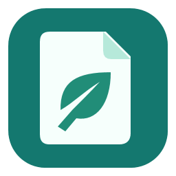
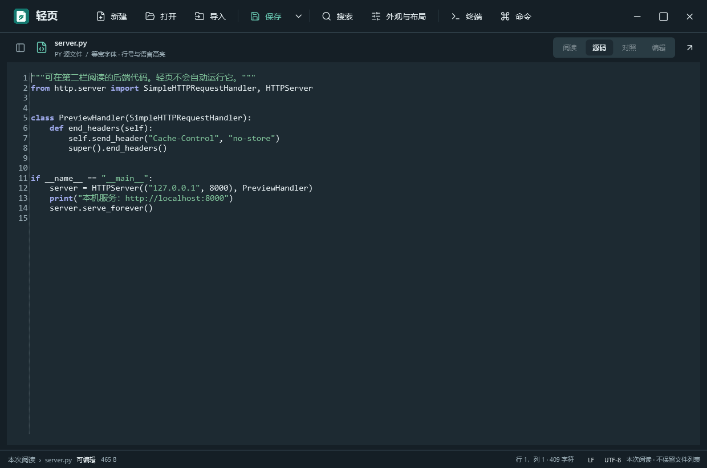
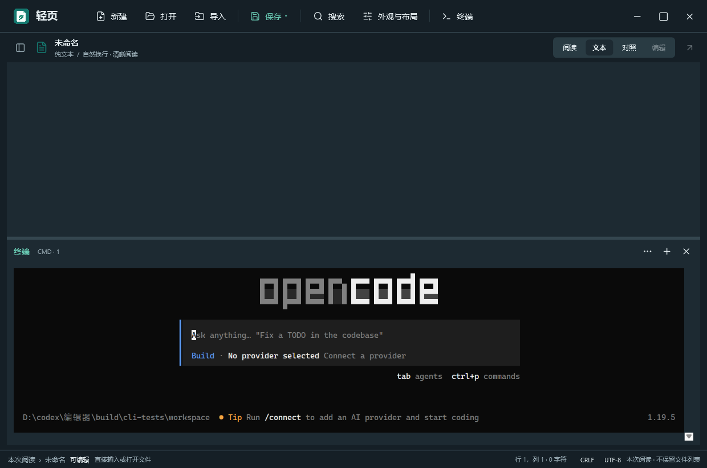
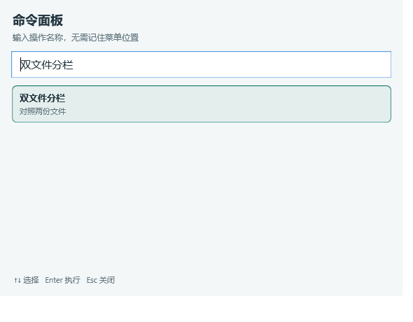

<div align="center">
  
  <h1>轻页 · Qingye</h1>
  <p><strong>一页，刚刚好。</strong><br />
  Windows 本地文件阅读与轻度编辑工具 · 原生 WPF · 打开即用</p>
  <p>
    <a href="https://github.com/TmxjTmxj/qingye/releases/latest"></a>
    <a href="https://github.com/TmxjTmxj/qingye/releases/latest"></a>
    
    
    
    
  </p>
  <p><a href="https://github.com/TmxjTmxj/qingye/releases/latest"><b>下载便携版</b></a> · <a href="docs/usage.md">使用说明</a> · <a href="docs/README.md">文档索引</a> · <a href="#从源码构建">源码构建</a></p>
</div>

<p align="center">
  
</p>

## 0.16 · 编辑手感与配色

这一版把"能读"推进到"好用"：字号随手缩放、Python 等代码文件按常见编辑器的习惯工作、字体与配色在四套主题下都保持清晰。

- **字号缩放**：编辑器内 `Ctrl+滚轮`，或 `Ctrl+=` / `Ctrl+-`，每档 10%（60%–250%），`Ctrl+0` 重置；状态栏显示当前缩放比例。
- **代码编辑便利**：Python 自动缩进、`Tab` / `Shift+Tab` 块缩进、括号与引号自动配对、`Ctrl+/` 切换注释、`Ctrl+D` 复制行、`Alt+↑/↓` 移动行，操作都合并为一次撤销。
- **字体与配色**：字体列表扩展到 9 种，非中文字体的中文统一回退 Microsoft YaHei UI；新增当前行高亮，四套主题的 6 个语法色对比度均不低于 4.5:1。
- **打印与提示**：任意视图下打印都有明确落点，不可打印格式直接说明；Markdown 含 HTML 时在阅读视图顶部提示按纯文本显示。

[0.16 完整说明](docs/experience-0.16.md) · [0.15 收尾记录](docs/experience-0.15.md) · [0.14 体验升级](docs/experience-0.14.md)

## 为什么是轻页

<div align="center">
<table>
<tr>
<td width="33%" valign="top">
<br />
<b>打开即读</b><br />
<sub>热启动约 0.4 秒，空白窗口约 87 MiB；普通阅读不拉起网页进程，不常驻后台服务。</sub>
</td>
<td width="33%" valign="top">
<br />
<b>按文件类型阅读</b><br />
<sub>Markdown 原生排版、JSON/XML 结构、CSV/XLSX 表格、DOCX/PPTX 基础阅读、EPUB 章节与图片预览。</sub>
</td>
<td width="33%" valign="top">
<br />
<b>改一点，不折腾</b><br />
<sub>文本与代码编辑、查找替换、编码与换行保留；需要终端与网页预览时再按需加载。</sub>
</td>
</tr>
</table>
</div>

<table>
<tr>
<td width="50%" valign="top"><br /><sub><b>深色主题 · Python 编辑</b>：语言高亮、当前行高亮与中文回退</sub></td>
<td width="50%" valign="top"><br /><sub><b>按需终端</b>：真实 CMD / ConPTY，支持 ANSI、TUI 与中文</sub></td>
</tr>
</table>

## 功能一览

| 阅读 | 编辑 | 按需辅助 |
| :--- | :--- | :--- |
| Markdown 原生排版、类型化阅读、大纲导航 | 文本与代码编辑、查找替换、编码和换行保留 | 多文件对照、格式导出、按需 CMD 面板 |
| 文本和 Markdown 阅读无需网页进程 | `Ctrl+滚轮` 缩放字号、代码缩进与配对 | 网页/PDF 预览及 CMD 会话按需启用 |
| 拖入即开、`Ctrl+P` 快速打开、`Ctrl+Shift+T` 重开 | 保存箭头左键展开，保存/另存/导出一步到位 | 中文命令面板 `Ctrl+Shift+P`，无需记菜单 |

## 按文件类型，选择合适的阅读方式

| 文件 | 当前能力 |
| :--- | :--- |
| TXT、日志、源码、配置 | 阅读与编辑；按类型选择字体、换行与语法高亮 |
| Markdown | 原生排版、源码、对照；可选受限子集原位编辑 |
| JSON / XML | 可展开结构视图与源码，保留原始内容 |
| CSV / TSV、XLSX | 表格阅读；XLSX 展示已有缓存值，不重算公式 |
| DOCX / PPTX / RTF | 基础文本与结构阅读，不还原完整 Office 版式 |
| EPUB、图片、PDF | 章节阅读、图片查看或系统运行时预览 |
| HTML / SVG | 源码与按需预览；可连接已运行的本机开发服务 |

导出支持 TXT、Markdown、HTML、DOCX、CSV、XLSX 和 PDF，能力取决于当前内容。详细格式限制、大小预算与转换边界见 [完整说明](docs/usage.md#文件范围) 和 [编辑与导出](docs/editing-and-export-0.5.md)。

## 终端与多窗口，按需启用

终端默认收起，首次展开才启动 Windows ConPTY、系统 CMD 和本地 xterm.js 渲染器。支持 ANSI 颜色、全屏 TUI、中文宽字符、组合字符、Emoji 字素、方向键及粘贴；尺寸随实际字符网格同步，底部和右侧均可停靠、拖动调整。

<details>
<summary>查看终端与中文输入实测</summary>


</details>

`Ctrl+C` 在选中文字时复制，否则中断；`Ctrl+Shift+C` 复制，`Ctrl+V` 粘贴，`Ctrl++/-/0` 调整终端字号。终端拥有普通命令行权限，可真实执行命令；收起保留会话，退出窗口结束所属进程。

每次启动都创建独立窗口；`Ctrl+Shift+N` 也能新开窗口。文档和终端相互独立，关闭一个窗口不会影响另一个。[终端说明](docs/terminal-0.13.md)

## 轻量化，也诚实

- 普通阅读与编辑保留原生 WPF；文本与 Markdown 阅读不启动网页进程。
- 终端与网页/PDF 预览按需启用已有系统 WebView2，打开后才会增加浏览器进程与内存。
- 没有常驻索引、账户、更新或终端后台服务；不会有遥测上报。
- 最近文件、阅读位置与草稿恢复分别可选，默认全部关闭，记录只保存在当前 Windows 用户的 `%LOCALAPPDATA%\Qingye`。
- GitHub 最新发布为 **v0.16.0**；便携包 SHA256 在同页 `SHA256.txt` 中。

## 开始使用

1. 从 [GitHub Releases](https://github.com/TmxjTmxj/qingye/releases/latest) 下载 Windows x64 便携 ZIP，并用同页 `SHA256.txt` 校验。
2. 解压后双击 `app/轻页.exe`，保留整个 `app` 目录。
3. 拖入文件，或按 `Ctrl+O` 打开；需要多个文件时按 `Ctrl+Shift+O` 导入。

需要 Windows x64 和 .NET Framework 4.8。网页、PDF、SVG 预览及集成终端需要系统 Microsoft Edge WebView2 Runtime；普通文本和原生阅读无需启用它。基础阅读与编辑不需要登录，CMD 面板需要 Windows 10 1809 或更高版本。

## 常用操作，一步到位

| 操作 | 快捷键 |
| :--- | :--- |
| 打开 / 导入多个文件 | `Ctrl+O` / `Ctrl+Shift+O` |
| 保存 / 另存为 | `Ctrl+S` / `Ctrl+Shift+S` |
| 快速打开 / 中文命令面板 | `Ctrl+P` / `Ctrl+Shift+P` |
| 重开刚关闭的文件 | `Ctrl+Shift+T` |
| 下一份 / 上一份文件 | `Ctrl+Tab` / `Ctrl+Shift+Tab` |
| 查找 / 展开替换 / 跳转行 | `Ctrl+F` / `Ctrl+H` / `Ctrl+G` |
| 阅读与源码切换 / 源码预览对照 | `Ctrl+E` / `Ctrl+Shift+V` |
| 文件与大纲 / 导入工作区 | `Ctrl+Shift+B` / `Ctrl+K` |
| 字号缩放 / 重置 | `Ctrl+滚轮` `Ctrl+=` `Ctrl+-` / `Ctrl+0` |
| 代码注释 / 复制行 / 移动行 | `Ctrl+/` / `Ctrl+D` / `Alt+↑` `Alt+↓` |
| CMD 面板 / 独立新窗口 | Ctrl+反引号 / `Ctrl+Shift+N` |



快速打开支持未保存文档、文件名模糊匹配、路径过滤，以及粘贴完整路径直接打开；可选显示本机最近文件。工作区扫描按需运行，最多 2000 个文件、6 层目录；关闭弹窗后取消，不建立磁盘索引。

## 已验证的体验与边界

| 项目 | 本机验证 |
| :--- | :--- |
| 便携包 | 0.16.0 ZIP 约 1.61 MiB；解压约 4.08 MiB，不含系统运行时（精确值见 `release/package-info.txt`） |
| 普通空白窗口 | 探针窗口初始化约 365–392 ms；空白工作集约 88.5 MiB；隐藏窗口热启动中位约 430 ms |
| 回归 | 65 项核心、83 项界面、4 项选择器检查，另有体验/多窗口/CMD 验收全部通过（合计 192 项） |
| 代码编辑 | Python 自动缩进、括号配对、注释切换、复制/移动行与撤销均有回归覆盖 |
| 配色 | 四套主题的 6 个语法色对表面色对比度 ≥ 4.5:1，当前行高亮随主题变化 |
| OpenCode 1.19.5 | 底部全屏、右侧窄面板实际界面通过 |
| Claude Code 2.1.316 | 启动文字通过；上游连接检查返回 403，完整交互尚未验收 |

测量仅代表本机条件，未清理系统缓存；打开终端的额外进程成本未计入普通空白窗口工作集。CLI 需要自行安装与配置，轻页不附带这些工具或模型凭据。[完整验证与复验方式](docs/terminal-0.13.md)

## 从源码构建

准备 Git，并在 Windows PowerShell 中执行：

```powershell
git clone https://github.com/TmxjTmxj/qingye.git
cd qingye
powershell -NoProfile -ExecutionPolicy Bypass -File scripts/restore.ps1
powershell -NoProfile -ExecutionPolicy Bypass -File scripts/test.ps1
powershell -NoProfile -ExecutionPolicy Bypass -File scripts/package.ps1
```

编译使用系统 .NET Framework C# 编译器，无需另装 .NET SDK。原生依赖锁定于 `packages.lock.json`；内置终端组件的版本与哈希记录在 `src/Assets/Terminal/vendor-lock.json`。首次准备需联网，之后可按文档复用离线依赖。

```text
src/        原生应用与 CMD 终端源码
tests/      核心、原生窗口与终端测试
scripts/    依赖准备、构建、测量、打包与整理
docs/       使用说明、设计记录、能力边界与验证
examples/   可选演示内容
licenses/   第三方许可与声明
```

`app/` 是本机运行目录，`release/` 保存便携包，`build/` 和 `artifacts/` 保存构建缓存与验证材料；这些生成目录不进入源码仓库。完整目录说明见 [项目布局](docs/project-layout.md)。

## 文档与许可

- [完整使用说明](docs/usage.md) · [文档索引](docs/README.md)
- [0.16 编辑手感与配色](docs/experience-0.16.md) · [0.15 收尾记录](docs/experience-0.15.md) · [0.14.1 内存与速度](docs/performance-0.14.1.md) · [0.14 体验升级](docs/experience-0.14.md)
- [0.13 终端改造](docs/terminal-0.13.md) · [0.12 改版记录](docs/native-0.12.md) · [发布与 SHA256 校验](docs/releasing.md)
- [第三方组件及许可](licenses/THIRD-PARTY-NOTICES.md)

第三方组件分别遵循其附带许可；本仓库暂未为轻页自身代码指定开源许可证。
