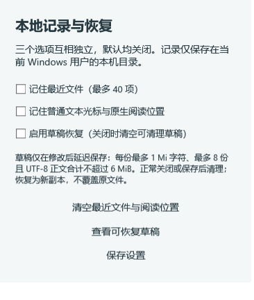

# 0.14：操作更直接，记录自己决定

本轮落实 0.13 体验检查中的六项改进，并补齐可选的最近文件、阅读位置和草稿恢复。保持原生 WPF，普通阅读不启动浏览器或终端，没有新增常驻服务。

## 常用操作

| 能力 | 操作与行为 |
| --- | --- |
| 保存下拉 | 主按钮保存，旁边的独立箭头左键展开另存、导出、打印；保留右键菜单 |
| 完整路径打开 | Ctrl+P 输入绝对路径，选择“打开此路径”；仅在确认后读取目标，不增加全盘索引 |
| 关闭后重开 | Ctrl+Shift+T 重开本次窗口最近关闭的已保存文件，恢复缓存光标；限 20 项，退出清空，不保留已放弃的未保存内容 |
| 中文命令面板 | Ctrl+Shift+P 或工具栏“命令”；可搜索导出 PDF、分栏、换行、终端位置、路径复制与本地记录设置 |
| 终端输出导航 | 终端内 Ctrl+F，上一处/下一处与匹配计数；Esc 退出；标题栏向下按钮回到最新输出 |
| 空白提示 | 原生轻提示显示打开、拖放与快捷键，输入或打开文件后隐藏 |
| 查找替换 | Ctrl+F 紧凑查找，Ctrl+H 展开替换；整词、匹配位置、F3/Shift+F3；工作区搜索仍为不区分大小写的普通文本，替换只作用于当前文件 |
| 文件路径 | 标签右键或命令面板复制完整路径/相对工作区路径；没有工作区时相对路径退化为文件名 |

终端标题明确标记会话“起始目录”，不冒充 CLI 运行后的实时目录；启动按钮复用当前会话，不伪装成新建标签。不随编辑文件切换去改变运行中的 CLI 工作目录。

## 三个可选开关

入口：“外观与布局 → 本地记录与恢复”，或命令面板搜索“本地记录”。三个选项相互独立，与“记住外观”分开；默认全部关闭，默认阅读、编辑、终端和查看设置均不创建记录目录。

- 最近文件：本机最多 40 项路径元数据，不自动恢复整个工作区。
- 阅读位置：普通文本光标、文本滚动与原生阅读滚动。本轮实际验证了文本与 Markdown 跨窗口恢复；不含大文件分段页码、网页/PDF 内部位置或 EPUB 章节。
- 草稿恢复：修改后约 8 秒提交快照到后台写入任务；每份最多 1 Mi 字符，每窗口最多 8 份，UTF-8 正文合计最多 6 MiB，JSON 不超过 8 MiB。单次恢复列表最多 16 项和 16 MiB 文件读取预算。

数据保存在当前 Windows 用户 `%LOCALAPPDATA%\Qingye`：`usage-options.json`、`usage-history.json` 与 `drafts/`。不需要后台服务或索引，不进入源码或 ZIP；开启后这些是本机文件，不是加密保险箱或云备份。

各窗口用独立草稿日志和活动锁；正在其他窗口编辑的内容不会列为可恢复草稿。恢复先生成新的未保存副本，确认新快照存在后才消费旧草稿；写入失败时保留旧恢复源，保存或确认关闭后再清理。原文件不被恢复操作覆盖。正常保存、确认关闭和关闭恢复开关会清理可清理快照。清空历史留有清空时间标记，避免旧窗口把旧缓存写回；草稿写入前也会在跨进程锁内核对最新开关。

快照有预算和延迟，不能保证恢复最后几秒或超大文件；只覆盖普通可编辑文本，不覆盖只读格式及尚未提交到源码的原位富文本修改。超预算内容跳过，不阻塞编辑。

## 验证

`scripts/test.ps1` 包括核心测试、界面、文件选择器、真实多窗口/CMD 和新增 `UsabilityTests.exe`。专项验证完整路径的真实弹窗打开、中文命令执行、首次保存/另存位置迁移、关闭重开、跨窗口光标与 Markdown 滚动位置、默认不落盘、终端搜索/回底部，以及独立进程退出后的草稿恢复与原文件保护。

`ExperienceHarness.exe terminal` 仍覆盖 ANSI、宽字符/字素、备用屏幕、缩放、实际 CLI 和进程清理。OpenCode 1.19.5 实际界面通过；Claude Code 2.1.316 启动文字通过，上游检查返回 403，完整交互仍未验收；没有使用用户凭据或发送模型任务。

固定新增官方组件 `@xterm/addon-search@0.16.0`，MIT；来源、SHA512 与 JS SHA256 纳入 `vendor-lock.json`，只在终端中按需创建搜索实例，不需要 Node。终端仍使用已有系统 WebView2。

本机普通空白窗口热启动五次中位数 473.3 ms，关闭中位数 43.8 ms，工作集约 91.6 MiB，空闲 CPU 中位采样为一个逻辑核心的 0.00%。未清理系统缓存，不属于严格冷启动测量。0.14.1 当时便携 ZIP 约 1.51 MiB、解压目录约 3.92 MiB，不包含系统运行时；后续版本包体以 `release/package-info.txt` 为准。

完整性能与包体以本地 `artifacts/metrics/experience-0.14-regression.txt`、`release/package-info.txt` 和 `release/SHA256.txt` 为准。普通窗口测量不包含开启终端的额外进程成本；截图与测试夹具位于忽略目录，不作为用户数据上传。
