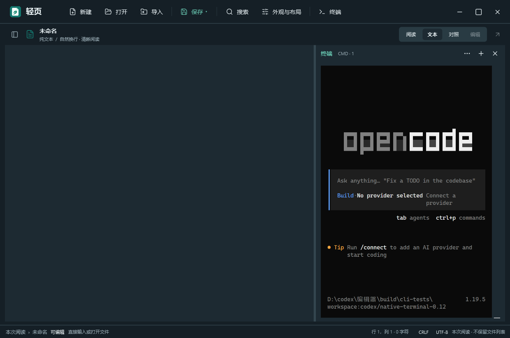

# 0.13：可用的集成终端

旧终端把控制序列整理成普通编辑器文本，无法正确保留 ANSI 属性、备用屏幕和字素宽度，复杂 CLI 会出现叠字与错位。0.13 删除这套简化解析器，采用 Windows ConPTY + xterm.js 6.0.0；交互习惯参考系统 CMD 和 VS Code 集成终端。

## 显示与操作

- ANSI 颜色、粗体、光标定位、清屏和 TUI 备用屏幕由成熟的终端引擎处理。
- 加载 Unicode graphemes 插件；中文双宽、组合重音和 ZWJ Emoji 按终端字符格处理。具体 Emoji 外观取决于系统字体。
- Fit 插件根据真实字体尺寸测量行列，通知 ConPTY；停靠切换、窗口缩放和显示缩放均重新适配，不再猜测每个字符的像素宽度。
- WebGL 加速可用时启用；不可用或上下文丢失时回退 DOM 渲染。
- Ctrl+C 有选区时复制，否则发中断；Ctrl+Shift+C 复制、Ctrl+V 粘贴，遵从程序的 bracketed paste；Ctrl++/-/0 调整字号。
- 底部/右侧停靠与拖动调整，收起保留会话，结束后点击 + 重开；菜单可在当前目录另开系统 CMD。

## 轻量与隔离

普通阅读不加载终端浏览器或 CMD。首次展开终端才启用系统 WebView2；这比旧纯文本终端多出浏览器进程与内存，换取复杂 CLI 的显示兼容性。未内置 Node、模型、账户或自动更新服务。

终端资源全部嵌入程序，通过内存中的固定页面提供，无 CDN、监听端口或运行时下载。页面拒绝网络资源、外部导航、下载、新窗口与权限请求。终端命令自身仍具有用户的普通权限，并按命令本身访问文件或网络。

输出队列施加背压并等待 xterm.write 确认，不丢弃控制序列；滚动历史限 5000 行。输入由独立写入任务处理。每窗口独立 ConPTY、子进程 Job 和临时 WebView 配置目录；关闭窗口时停止所属进程并清理配置。崩溃或系统阻止删除时，临时目录可能留存。

组件固定版本：xterm 6.0.0、fit 0.11.0、unicode-graphemes 0.4.0、webgl 0.19.0、search 0.16.0（终端内查找用 `@xterm/addon-search`）。来源与完整性见 `src/Assets/Terminal/vendor-lock.json`，许可见 `licenses/xterm-LICENSE.txt`。使用已有系统 WebView2；未将 WebView2 Runtime 打入便携包。

## 验收范围

本机专项验收包括 ANSI 色彩/粗体单元格、中文/组合重音/ZWJ Emoji 宽度、ConPTY 与渲染器尺寸一致、备用屏幕退出恢复主屏、125% 缩放、停靠与进程清理。

实际启动 OpenCode 1.19.5，在无提供商、隔离配置目录下检查底部全屏与右侧窄面板；CLI 自行按空间调整布局。Claude Code 2.1.316 的欢迎和错误文字显示正常，但上游启动连接检查返回 403，未进入完整交互界面，不能声称已完成 Claude 的交互验收。未使用用户凭据或提交模型任务。

集成终端不包含 Claude Code / OpenCode，也不会自动安装它们；用户安装后可从 CMD 启动。某个 CLI 的登录、服务可用性或特定系统字体问题仍需独立处理。没有承诺与 Windows Terminal 的所有扩展行为完全一致。

## 本机观察

普通空白阅读窗口：热启动五次中位数约 463 ms，关闭中位数约 39 ms，工作集约 90 MiB，空闲 CPU 采样为一个逻辑核心的 0.00%。首次观察约 473 ms，未清理操作系统缓存，不能视为严格冷启动。终端关闭时没有 WebView 或 CMD 进程；开启终端的额外进程成本未纳入该工作集。

回归：60 项核心、62 项界面、4 项文件选择器检查，以及实际多窗口、CMD 输入/中断均通过。专项覆盖启动失败后的重试、初始化期间停止、自然 exit 后重开、关闭所属 CLI/浏览器进程。实际键盘检查确认首次展开与收起后重开可直接输入，无需再点击画布；编辑文档没有被误输入。浅色终端底色与输入法合成浮层跟随主题。

## 复验

常规回归：`powershell -NoProfile -ExecutionPolicy Bypass -File scripts/test.ps1`。

终端专项：构建后执行 `build/bin/ExperienceHarness.exe terminal`；需要 PATH 中的 Claude Code，以及本地隔离测试夹具 `build/cli-tests/tools/opencode.exe`（1.19.5）。专项创建的配置、截图、日志位于被忽略的 `build/` 和 `artifacts/`，不进入发布包。Claude 上游阻断会输出明确的 LIMIT，不算完整交互通过。

包体与哈希：执行 `tests/ScriptTests.ps1`，验证终端内置资源、发布白名单、敏感/历史运行时排除及每个 ZIP 条目 SHA256。`release/package-info.txt` 提供当前本机包体测量；性能数据仅代表本机环境。

## 工程参考

- [xterm.js 官方项目与内置插件](https://github.com/xtermjs/xterm.js)
- [VS Code 终端显示与字体设置](https://code.visualstudio.com/docs/terminal/appearance)
- [Claude Code 环境变量与隔离配置目录](https://code.claude.com/docs/en/env-vars)
